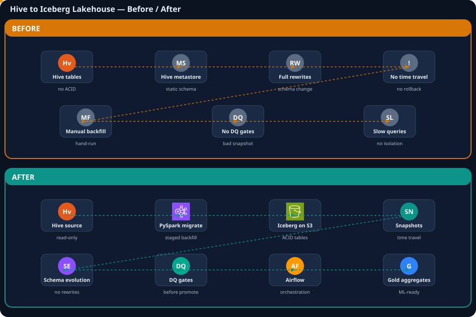

# Hive to Apache Iceberg Lakehouse Migration

Portfolio implementation based on production work experience. All data is synthetic, all code is original and clean-room, and no proprietary code, data, schema names, or internal system details from any employer are included.

**Original context:** Data platform rebuild migrating Hive tables to Apache Iceberg to get ACID transactions, schema evolution and snapshot time travel, with PySpark pipelines orchestrated by Airflow and an ML demand product built on top.

**This portfolio version:** A runnable local implementation using PySpark-style transformations structured so the same code maps to Iceberg tables on S3 in production. Synthetic automotive parts and service data only.

## Architecture


```
raw (CSV landing) -> bronze (cleaned, partitioned) -> silver (Iceberg-style curated) -> gold (aggregates)
                         |                                   |
                    data quality checks               snapshot / time-travel reads
```
## Run

### Before / After

Hover any component to see what it is and why it is needed.


<details>
<summary><b>Backfill + snapshot — click to expand the 4 steps</b></summary>

Collapsed, this is just: Hive source -> PySpark migrate -> Iceberg on S3 -> Snapshots

1. The original Hive tables stay as the source, so nothing is lost during migration.
2. PySpark jobs migrate tables in stages, so each table is proven before it moves.
3. Iceberg tables on S3 give ACID transactions, so writes are atomic and safe.
4. Every write creates a snapshot, so any earlier version can be read or rolled back to; readers pin a snapshot, so the old and new versions can be compared before cutover.
</details>

### Earlier issues, risk, and impact after

| Aspect | Detail |
|---|---|
| Earlier issues | Hive tables with no transactions, so a failed write could leave partial data; a static metastore where schema changes needed rewrites; no way to read an earlier snapshot, so a bad load could not be rolled back cleanly; backfills run by hand, easy to get wrong and hard to repeat; no quality gate before a snapshot is promoted; readers and writers shared the same state, so queries could see half-written data. |
| Risk | A failed write could leave partial data behind; a bad load could become the current version with no clean rollback; a hand-run backfill that went wrong had to be redone from scratch; changing a schema meant rewriting history. |
| Impact after | Writes are atomic with ACID transactions; schema and partition changes apply without rewriting history; snapshot isolation lets readers pin a version while writers append a new one; DQ gates run before a snapshot is promoted; Airflow orchestrates the migration in stages. |


```bash
python -m src.generate_data --rows 5000 --out data/raw
python -m src.migrate --input data/raw --output data/curated
python -m src.time_travel --snapshot latest
python -m pytest tests/ -q
```
## Key ideas demonstrated
- Partition evolution and schema evolution without rewriting history
- Snapshot isolation: readers pin a snapshot, writers append a new one
- Idempotent, re-runnable Spark jobs with watermarking
- Data quality gates before a snapshot is promoted
