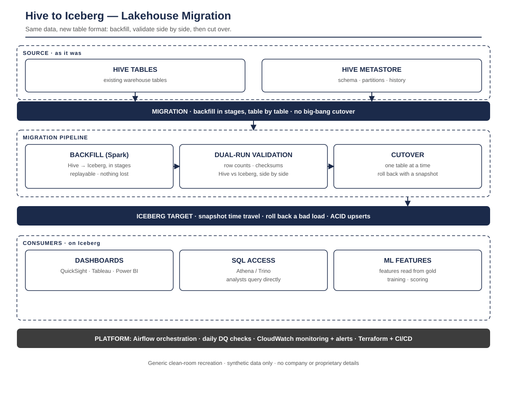

# Hive to Apache Iceberg Lakehouse Migration

Portfolio implementation based on production work experience. All data is synthetic, all code is original and clean-room, and no proprietary code, data, schema names, or internal system details from any employer are included.

**Original context:** Data platform rebuild migrating Hive tables to Apache Iceberg to get ACID transactions, schema evolution and snapshot time travel, with PySpark pipelines orchestrated by Airflow and an ML demand product built on top.

**This portfolio version:** A runnable local implementation using PySpark-style transformations structured so the same code maps to Iceberg tables on S3 in production. Synthetic automotive parts and service data only.

## Architecture


```
raw (CSV landing) -> bronze (cleaned, partitioned) -> silver (Iceberg-style curated) -> gold (aggregates)
                         |                                   |
                    data quality checks               snapshot / time-travel reads
```
## Run
```bash
python -m src.generate_data --rows 5000 --out data/raw
python -m src.migrate --input data/raw --output data/curated
python -m src.time_travel --snapshot latest
python -m pytest tests/ -q
```
## Key ideas demonstrated
- Partition evolution and schema evolution without rewriting history
- Snapshot isolation: readers pin a snapshot, writers append a new one
- Idempotent, re-runnable Spark jobs with watermarking
- Data quality gates before a snapshot is promoted
